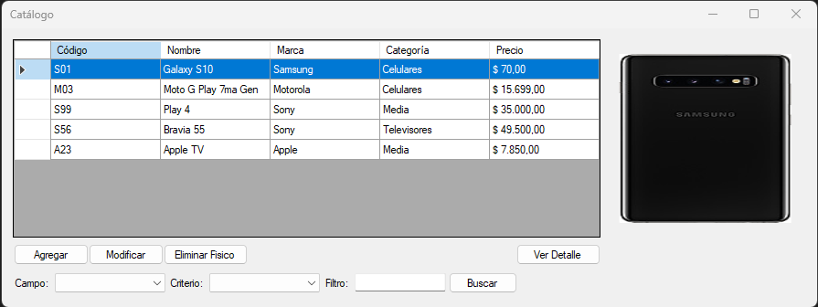

# Gestor de Catálogo de Artículos

Aplicación de escritorio para administrar el catálogo de productos de un comercio: alta, modificación y baja de artículos, con marca, categoría, precio e imagen, y búsqueda con filtros.

Trabajo final del curso **C# Nivel 2** de MaxiPrograma.



## Funcionalidades

- **Listado** de artículos en una grilla, con la imagen del artículo seleccionado.
- **Alta y modificación** de artículos: código, nombre, descripción, marca, categoría, URL de imagen y precio, con validación de campos.
- **Eliminación** con confirmación previa.
- **Filtros** por código, nombre, marca o categoría (comienza con / termina con / contiene) y por precio (mayor a / menor a / igual a).
- **Detalle** del artículo seleccionado.
- Imagen por defecto cuando la URL del artículo no es válida.

## Tecnologías

- C# · .NET Framework 4.8
- Windows Forms
- SQL Server (Express) con ADO.NET

## Arquitectura

La solución está separada en tres capas, cada una en su propio proyecto:

| Proyecto | Responsabilidad |
|---|---|
| `dominio` | Clases del modelo: `Articulo`, `Marca`, `Categoria`. |
| `negocio` | Lógica y acceso a datos: `ArticuloNegocio`, `MarcaNegocio`, `CategoriaNegocio` y la clase `AccesoDatos`, que centraliza la conexión, los comandos y los parámetros. |
| `presentacion` | Formularios WinForms: `frmArticulos` (listado y filtros) y `frmAltaArticulo` (alta y modificación). |

`presentacion` depende de `negocio` y `dominio`; `negocio` depende de `dominio`.

Todas las consultas a la base de datos usan parámetros (`SqlParameter`) para prevenir inyección SQL, incluidas las búsquedas con filtros.

## Cómo ejecutarlo

**Requisitos:** Windows, Visual Studio (con el workload de desarrollo de escritorio .NET) y SQL Server Express.

1. Cloná el repositorio:
   ```bash
   git clone https://github.com/AgusEma/APP-GESTION-CATALOGO.git
   ```
2. Creá la base de datos ejecutando el script [`database/CATALOGO_DB.sql`](database/CATALOGO_DB.sql) en SQL Server Management Studio.
3. Abrí `TPFinalNivel2_Allocco/TPFinalNivel2_Allocco.sln` en Visual Studio.
4. Si tu instancia de SQL Server no se llama `.\SQLEXPRESS`, ajustá la cadena de conexión en `negocio/AccesoDatos.cs`.
5. Marcá `presentacion` como proyecto de inicio y ejecutá con **F5**.

## Autor

**Agustín Allocco** — Estudiante de Ingeniería en Sistemas de Información, UTN Facultad Regional Villa María.
[LinkedIn](https://www.linkedin.com/in/agustin-allocco/)
